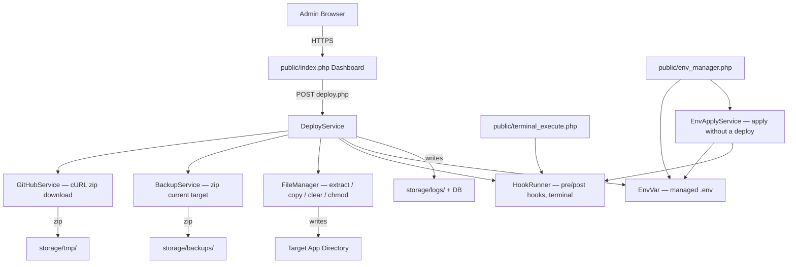
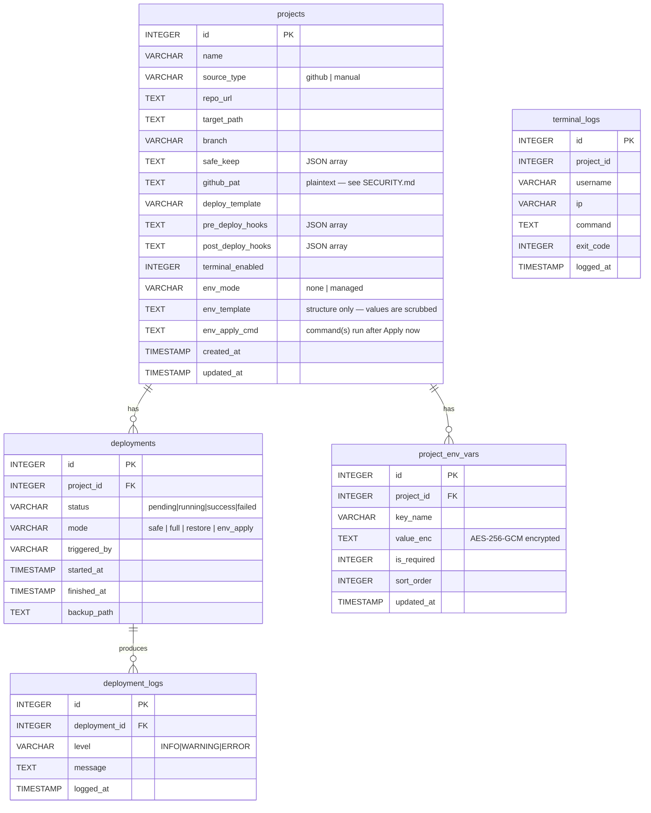
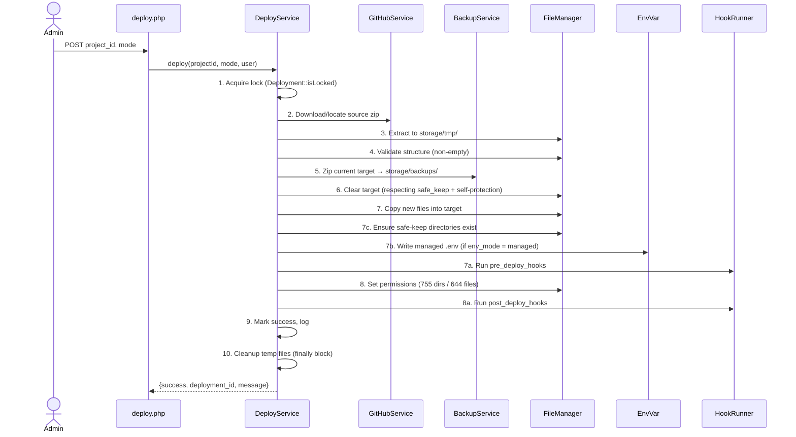

# Architecture

Technical reference for how TeraPH Web Deployer is put together. For product-level
requirements see [REQUIREMENTS.md](REQUIREMENTS.md); for what's implemented right now see
[PROGRESS.md](PROGRESS.md).

---

## 1. System Overview

TeraPH is a single-tenant, framework-less PHP application. There is no build step, no
Composer dependency at runtime, and no background worker — every request is handled
synchronously by the PHP process (built-in dev server or Apache + PHP-FPM/mod_php).



Every public entry point calls `app_boot()` ([app/helpers.php](../app/helpers.php)), which
loads `app/bootstrap.php` (single `require_once` chain for all classes — no autoloader),
runs all pending migrations (idempotent, safe on every request), and starts the PHP
session. There is no router; each `.php` file under `public/` is its own endpoint.

---

## 2. Directory Structure

```text
/deployer
├── config.php                     # Active config — GITIGNORED
├── config.php.example             # Template — commit this, not config.php
├── tera                           # CLI entry point: php tera <command>
├── server.php                     # PHP built-in dev server router
│
├── app/                           # NOT web-accessible (.htaccess Deny from all)
│   ├── bootstrap.php              # require_once chain for every class
│   ├── Auth.php                   # Session auth, idle timeout
│   ├── Database.php               # PDO factory (SQLite / MySQL)
│   ├── helpers.php                # CSRF, flash, formatters, self-protection, env crypto
│   ├── Models/
│   │   ├── Project.php
│   │   ├── Deployment.php
│   │   ├── DeploymentLog.php
│   │   └── EnvVar.php             # Per-project encrypted .env variable storage
│   └── Services/
│       ├── GitHubService.php      # cURL zip/API download with PAT support
│       ├── FileManager.php        # extract / copyContents / clear / setPermissions
│       ├── BackupService.php      # Zip backup + restore (deployer-aware, symlink-aware)
│       ├── HookRunner.php         # proc_open command execution, {composer} resolution
│       ├── EnvApplyService.php    # "Apply now": write the managed .env without a deploy
│       └── DeployService.php      # Deployment pipeline orchestrator
│
├── migrations/                    # NOT web-accessible. Additive only — see DECISIONS.md
│   ├── 001_initial_schema.php
│   ├── 002_manual_upload_support.php
│   ├── 003_project_hooks_terminal.php
│   ├── 004_project_env_manager.php
│   ├── 005_env_apply_command.php
│   └── 006_scrub_env_templates.php
│
├── public/                        # Web root — point your domain here
│   ├── index.php                  # Dashboard: project list, deploy modal, project form
│   ├── login.php / logout.php
│   ├── deploy.php                 # POST = run pipeline, GET ?action=status
│   ├── logs.php                   # AJAX: ?deployment_id=X or ?project_id=X
│   ├── backups.php                # AJAX backup list + restore
│   ├── projects.php               # AJAX project CRUD
│   ├── settings.php                # Installation-wide read-only overview
│   ├── settings_action.php        # AJAX: clear_tmp, deploy_reconcile
│   ├── env_manager.php            # Per-project .env editor (template, values, live .env, bulk tools)
│   ├── migrate.php                # Browser-based migration runner
│   ├── update.php                 # Self-update from GitHub
│   ├── terminal_execute.php       # Streaming terminal endpoint (audited, guarded)
│   ├── composer_download.php      # Download + SHA-256-verify composer.phar
│   ├── webhook.php                # Stub — not yet implemented, see TODO.md
│   └── assets/{css,js}/
│
├── storage/                       # NOT web-accessible
│   ├── backups/                   # Pre-deploy zip backups
│   ├── tmp/                       # Temp zip downloads/extractions, composer cache
│   ├── logs/                      # Flat deployment log files + terminal audit log
│   ├── archives/                  # Saved manual-upload source zips
│   ├── deploy_strategy.txt        # Cached symlink capability result (auto mode)
│   └── deployer.db                # SQLite database (default driver)
│
├── scripts/
│   ├── install.php                # Single-file bootstrap installer
│   ├── probe.php                  # CLI-only install diagnostics (delete after use)
│   └── reset_db.php               # CLI-only full data wipe for clean testing
│
├── test/
│   └── bootstrap_test.php         # CLI diagnostic script
│
└── docs/
    ├── ARCHITECTURE.md            # This file
    ├── REQUIREMENTS.md
    ├── DEVELOPMENT.md
    ├── USER.md
    ├── PROGRESS.md
    ├── TODO.md
    ├── DECISIONS.md
    ├── CHANGELOG.md
    ├── SECURITY.md
    └── archive/                   # Superseded Phase-1 planning documents
```

---

## 3. Technology Stack

| Component | Technology | Rationale |
| --- | --- | --- |
| Backend | PHP 8.1+, no framework | Maximum cPanel shared-hosting compatibility |
| Class loading | Manual `require_once` chain in `bootstrap.php` | No Composer dependency required at runtime |
| UI | Server-rendered HTML + vanilla JS + custom CSS | No build step, no CDN framework dependency |
| HTTP client | PHP cURL | Native, no external libraries |
| Archive ops | PHP `ZipArchive` | Native zip support for backups & extraction |
| Database | PDO — SQLite (default) or MySQL/MariaDB | Portable via DSN change only, see §4 |
| Process execution | `proc_open` (`HookRunner`) | Streams stdout/stderr for hooks and terminal |
| Source code | GitHub zip/API download | Avoids Git/SSH dependency on shared hosting |
| Encryption | `openssl` AES-256-GCM (CBC fallback) | Encrypts stored `.env` values, see §6 |

---

## 4. Data Layer

### 4.1 Database Abstraction

All queries use PDO with named parameters — no string interpolation, no SQLite-specific
constructs (`PRAGMA`, `AUTOINCREMENT`, `DATETIME('now')`). Switching `DB_DRIVER` in
`config.php` from `sqlite` to `mysql` is the only required change
([app/Database.php](../app/Database.php)).

### 4.2 Schema (as of migration 004)



Migrations are strictly additive (`ADD COLUMN` / `CREATE TABLE IF NOT EXISTS` only) and
idempotent — every migration file is safe to re-run and is in fact re-run on every request
via `app_boot()`. See [DECISIONS.md](DECISIONS.md) for why.

---

## 5. Deployment Pipeline

`DeployService::deploy()` ([app/Services/DeployService.php](../app/Services/DeployService.php))
runs the following steps synchronously inside the HTTP request that triggered it:



Key implementation notes:

- **Synchronous, not queued.** The whole pipeline runs in the web request. Large repos or
  slow hooks can hit PHP/gateway timeouts — this is a known limitation, see TODO.md P1.1.
- **Per-project lock**, not global — `Deployment::isLocked()` checks for an existing
  `running` row for that project only.
- **Failure handling**: any `Throwable` inside the pipeline is caught, logged as `ERROR`,
  and the deployment is marked `failed`. The `finally` block always cleans up temp files
  regardless of outcome. There is **no automatic rollback** to the pre-deploy backup on
  failure yet — the backup exists but must be restored manually via the Backups UI. See
  TODO.md P0.2.
- **Env-managed `.env` interacts with `safe_keep`**: if `env_mode = 'managed'`, `.env` is
  removed from the effective `safe_keep` skip list so the freshly rendered file always wins
  over whatever `safe_keep` would have preserved.

---

## 6. Deploy Strategy (copy vs. symlink)

`detect_deploy_strategy()` ([app/helpers.php](../app/helpers.php)) resolves
`DEPLOY_STRATEGY`:

- `'copy'` — always copy-in-place (today's only fully implemented strategy).
- `'symlink'` — intended for atomic releases; **not yet implemented** in `DeployService`
  (the pipeline always calls `FileManager::clear()` + `copyContents()`). The detection
  function and config flag exist as groundwork; see TODO.md P0.1.
- `'auto'` (default) — tests `symlink()` capability once against `storage/tmp/`, caches the
  result in `storage/deploy_strategy.txt`. Since the symlink pipeline isn't implemented yet,
  auto-detection currently only affects what's logged, not pipeline behavior.

---

## 7. Self-Protection (deployer-inside-target)

When the deployer's own installation directory lives inside a project's `target_path`
(e.g. deploying the whole `public_html/` webroot that also contains `deployer/`), a normal
Full deploy would delete the deployer itself.

`is_deployer_inside_target()` / `deployer_relative_path()` ([app/helpers.php](../app/helpers.php))
detect this via `realpath()` comparison (symlink-aware, separator-agnostic). When detected:

- `DeployService` auto-appends the deployer's relative path to `$skipPaths` before
  `clear()` and `copyContents()` — the same mechanism used for `safe_keep`.
- `BackupService` excludes the same subtree from the pre-deploy zip.
- The dashboard shows a **"⚠ Deployer inside target"** badge on the affected project card.

---

## 8. .env Manager

Per-project managed environment variables ([app/Models/EnvVar.php](../app/Models/EnvVar.php),
[public/env_manager.php](../public/env_manager.php), migration 004).

- **Off by default** (`env_mode = 'none'`) — `.env` is left to `safe_keep` like any other
  file. Toggling to `'managed'` makes the deployer own `.env` completely.
- **Template + values split.** A project stores one `env_template` (the raw `.env.example`
  or `.env` text, comments and structure preserved) and a set of `project_env_vars` rows
  (one per key). `EnvVar::syncKeys()` keeps the two in sync: new keys in the template are
  added, keys removed from the template are deleted, existing values are preserved across
  edits.
- **Values are encrypted at rest** with AES-256-GCM (`env_encrypt`/`env_decrypt` in
  `app/helpers.php`), keyed off `SECRET_KEY` (falls back to `APP_PASSWORD_HASH` if unset —
  see SECURITY.md for the risk this creates).
- **Rendering** (`EnvVar::renderDotEnv()`): merges decrypted values into the template
  (`env_render()`), preserving comments/blank lines and the `export ` prefix if present. If
  no template is stored, falls back to a flat `KEY=value` listing.
- **Written at deploy time or on demand** (`DeployService` step 7b, or `EnvApplyService`), directly to
  `{target_path}/.env`. A deploy halts before any file changes reach the target if a
  required key (`is_required = 1`) has an empty value.
- **Never logged.** Deploy log entries never contain env values; the in-UI preview masks
  all non-empty values.
- **Stored template is structure only.** `EnvVar::setTemplate()` blanks every value
  (`env_template_scrub()`), so secrets live only encrypted in `project_env_vars`. Migration 006
  applies the same to older templates via `EnvVar::scrubTemplate()`.
- **Shared write/preflight.** `EnvVar::assertDeployable()` (no unreadable or empty-required
  values) and `EnvVar::writeToTarget()` (render + `0640` write) are used by both the deploy
  pipeline and `EnvApplyService`, so the two cannot drift apart.
- **Apply now** (`EnvApplyService::apply()`): preflight → write → optional stored command via
  `HookRunner`. Recorded as a `deployments` row with `mode = 'env_apply'`, which also takes the
  per-project lock.
- **Drift** (`EnvVar::drift()`): parses the rendered output and the on-disk file with
  `env_parse_pairs()` and diffs them by key (`env_diff_pairs()`); only names are ever returned.
- **Merging** (`EnvVar::merge()`) is the one routine behind Pull from live, Copy from project and
  bundle import; it never deletes and keeps every stored key listed in the template.
- **Multi-line values.** `env_logical_lines()` joins a quoted value spanning several lines into
  one entry (an unclosed quote never swallows the rest of the file). The page shows such values
  escaped (`env_escape_lines()`) and decodes flagged rows on save.
- **Atomic writes.** Multi-row operations run in `EnvVar::transaction()`.

---

## 9. Web Terminal & Hooks

`HookRunner` ([app/Services/HookRunner.php](../app/Services/HookRunner.php)) is the single
`proc_open` wrapper shared by two callers:

1. **Deploy hooks** — `DeployService` steps 7a/8a run `pre_deploy_hooks`/`post_deploy_hooks`
   (JSON arrays on the `projects` row, pre-filled by `deploy_template` presets) inside
   `target_path`. Non-zero exit halts the pipeline.
2. **Web terminal** — [public/terminal_execute.php](../public/terminal_execute.php) streams
   ad-hoc commands to the browser for a single project, always CWD-locked to that project's
   `target_path`. Every command is written to the `terminal_logs` table (user, IP, command,
   exit code) with a flat-file fallback at `storage/logs/terminal_audit.log`.

Both resolve the `{composer}` placeholder via `HookRunner::resolveComposer()`: prefers a
project-local `composer.phar`, then a global `composer` binary, then falls back to
`php composer.phar` (downloadable via `public/composer_download.php` with SHA-256
verification against the published `getcomposer.org` hash).

`HookRunner::buildEnv()` ensures `HOME`/`COMPOSER_HOME` are set for the child process —
required because web server processes often run without `HOME`, which otherwise makes
Composer abort.

---

## 10. FileManager Semantics

[app/Services/FileManager.php](../app/Services/FileManager.php) is the only class that
touches the filesystem for deploy/backup/restore operations.

- **`extract()`** — strips the top-level wrapper folder GitHub zips add (`repo-branch/`) so the
  deployed structure matches the repo root, but only when that folder is the sole entry
  (`scandir`, so dotfiles count). Callers with an exact layout — backup restore — pass
  `$stripWrapper = false`.
- **`copyContents()` / `clear()` / `setPermissions()`** all take a `$skipPaths` array of
  paths relative to the root being operated on — the same list (safe_keep ∪
  self-protection) flows through all three so a path is either fully preserved or fully
  replaced, never partially touched.
- **Symlink-safe deletion.** `clear()` and `deleteDirectory()` detect `SplFileInfo::isLink()`
  and `unlink()` the link itself via `getPathname()` rather than resolving through
  `getRealPath()` — this prevents recursively deleting whatever the symlink points to
  (which could be outside the webroot entirely). This was a deliberate fix; see
  DECISIONS.md.
- **`realpath()`-normalized comparisons throughout** — all three mutating methods resolve
  the operating root to its canonical real path before comparing against skip paths, so
  behavior stays correct even when the webroot itself is reached via a symlink.

---

## 11. Security Model Summary

See [SECURITY.md](SECURITY.md) for the full picture. Summary of what's structurally true
about the architecture:

- Every `public/*.php` entry point calls `Auth::require()` except `login.php`.
- All state-changing POST requests go through `csrf_verify()`.
- `/app`, `/migrations`, `/storage` are blocked at the web-server level via `.htaccess`
  `Deny from all` — not just by convention.
- The deployer **never operates on an arbitrary path supplied by request input** — every
  file operation targets a `target_path` looked up from the `projects` table.

---

*End of Document — Architecture Reference*
